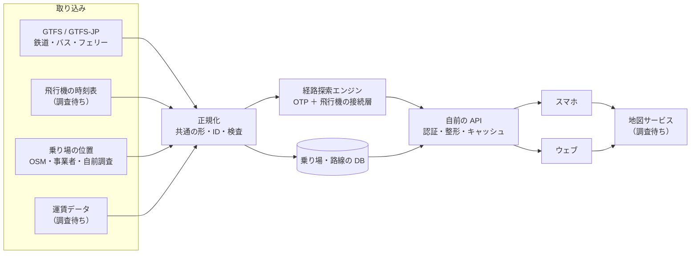
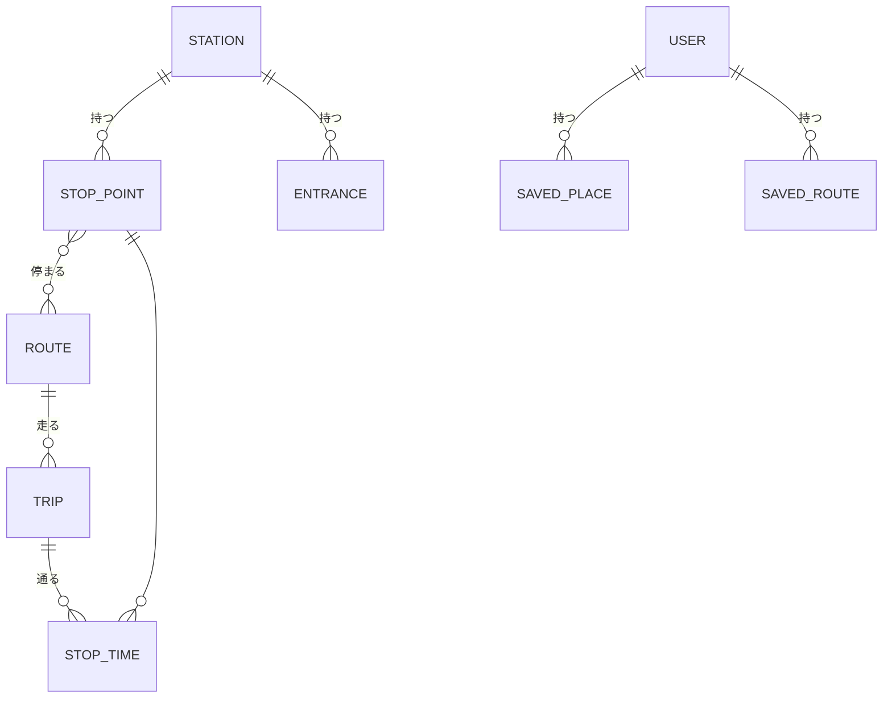

# 全世界交通インフラ統合アプリ　中枢システム設計（第 1 版・2026-10-18）

> **【レビュー注記・2026-10-19】** 本書は第 1 版のまま残す。批判的レビューと検証結果は `docs/review-architecture.md`、改訂後の設計は `docs/core-design.md`・`docs/data-pipeline.md`・`docs/platform-precision.md`・`docs/accounts-privacy.md`・`docs/roadmap.md` にある。主な変更点：経路エンジンは自作 RAPTOR（`decisions.md`）、飛行機は同じエンジンに「余裕つきの便」として入れる、段階の順番は 首都圏の仕上げ → 飛行機 → アカウント → 全国、東京メトロは CC BY ではなく基本ライセンス、JR 東日本と大手私鉄 7 社はチャレンジ限定のみ、国内線の時刻表は ODPT にある。

> 記号：**推**＝推測、**不明**＝分かっていない、**調査待ち**＝並行調査（`research-japan-data.md`・`research-maps.md`）の結果で直す所。
> 作成時点で 2 つの調査文書はまだ無い。依存箇所は選択肢と推奨だけ書いてある。

## 結論（非エンジニア向け要約）

1. 経路計算は自前で一から作らず、オープンソースの **OpenTripPlanner（OTP）** を土台にする（推奨）。
2. 鉄道・バス・フェリーは「時刻表データ（GTFS 形式）」で、飛行機は「空港間の便データ」で同じ仕組みに入れる。
3. 飛行機は「家→空港」「空港→目的地」を地上の経路で計算し、搭乗手続きの余裕（国内 推 30〜45 分）を足してつなぐ。
4. 答えは 1 本でなく「最速」「乗り換え最少」「安い（運賃が取れる路線だけ）」の 3 案を出す。
5. 地図は既存サービスを使い、乗り場の位置（出入口・ホーム・バス停の向き）は自前のデータで上書きして正確にする。
6. 日本全国の時刻表はサーバ 1〜2 台のメモリに乗る規模の見込み（推）。
7. アカウントはメールかスマホのログインで作り、保存するのは「お気に入り経路」「よく使う場所」だけ。移動の履歴は既定で端末の中だけに置く。
8. 最初は 1 都市圏の鉄道だけで試し、全国 → 飛行機 → アカウント → 海外の順に広げる。
9. 最大の不確定要素は「日本の鉄道（特に JR・大手私鉄）の時刻表と運賃を正式に使えるか」（調査待ち）。
10. ユーザーに決めてほしいことは末尾に 5 つ。

---

## 1. 全体構成



### 自前で作る所・任せる所

| 部分 | 選択肢 | 推奨 | 理由 |
|---|---|---|---|
| 時刻表の取り込み | 自前の変換スクリプト | **自前** | 国・事業者ごとの癖を吸収する所で、差が出る |
| 経路探索（地上） | ①OTP ②MOTIS ③自前（RAPTOR 実装） ④外部 API（Google Directions 等） | **①OTP** | 実績が多く GTFS・徒歩・自転車を扱える。②も有力で飛行機に近い長距離に強いとされる（推）。④は日本の鉄道の網羅は高いが費用と利用規約の制約（結果の保存・加工の制限 推）が大きい |
| 飛行機の接続 | ①便を GTFS 化して OTP に入れる ②別層で地上経路と組み合わせる | **②** | 搭乗手続き・保安検査の余裕、予約の要否など鉄道と性質が違う。①は試作の簡略版として可 |
| 運賃計算 | ①GTFS-Fares ②事業者・外部の運賃 API ③自前の表 | 調査待ち | 日本の鉄道運賃は距離制・通算規則が複雑。②が現実的と推 |
| 地図の表示 | ①Mapbox/MapLibre ＋ OSM 系タイル ②Google Maps ③Apple MapKit | 調査待ち（仮に①） | ①は費用が読みやすく自前データを重ねやすい（推） |
| 乗り場の位置データ | OSM ・事業者・自前で整備 | **自前の DB（OSM を下地）** | 「正確な乗り場」がこのアプリの差別化点 |
| 認証 | ①Supabase Auth ②Firebase Auth ③自前 | **①か②** | 自前の認証は危険が大きい |
| API | 自前（薄く） | **自前** | エンジンを差し替えられるよう画面とエンジンを直結しない |

## 2. 経路探索の中核

### 2.1 地上（鉄道・バス・フェリー）

- OTP の時刻表ベース探索（RAPTOR 系）を使う。フェリーも GTFS に入っていれば同じ扱い。
- 乗り換え時間：駅ごとの最小乗換時間（GTFS の `transfers.txt`）を整備。大きな駅（新宿・東京など）は出入口・ホーム間の歩行時間を自前で持つ（3 章）。

### 2.2 飛行機の統合（2 段の組み立て）

```
出発地 ─地上探索→ 出発空港 ─[余裕 Tdep]→ 便 ─[余裕 Tarr]→ 到着空港 ─地上探索→ 目的地
```

1. 出発地・目的地の近くの空港候補を距離と地上所要で各 2〜3 港に絞る。
2. 「出発地→各空港」と「各空港→目的地」を地上エンジンで計算（到着側は便の到着時刻から出発）。
3. 空港の組 × 便を総当たりし、余裕を足して成り立つ組だけ残す。
   - Tdep（出発前の余裕）：国内 推 30〜45 分、国際 推 120 分。空港ごと・航空会社ごとに上書き可。
   - Tarr（到着後）：国内・預け荷物なし 推 10〜15 分、あり 推 25 分。
   - 乗り継ぎ：最小乗継時間（MCT）を空港ごとに持つ（データ源は調査待ち）。
4. 地上だけの経路（新幹線など）とも並べて比較する。飛行機を使うかどうかは結果で決める。
- 便は予約制なので「時刻と所要の目安」として表示し、空席・運賃の確定はしない（初期）。

### 2.3 複数案

| 案 | 基準 | 備考 |
|---|---|---|
| 最速 | 到着時刻が最も早い | OTP の標準 |
| 乗り換え最少 | 乗り換え回数 → 到着時刻 | RAPTOR は回数ごとの最良解を自然に出せる |
| 安い | 運賃合計 | 運賃が取れる区間だけ。取れない区間は「運賃不明」と表示し順位に入れない |
| （任意）歩き少なめ | 歩行距離 | 後から |

### 2.4 規模と計算量（日本全国の目安・すべて推）

| 項目 | 目安 |
|---|---|
| 停留所（駅・バス停） | 20〜30 万 |
| 1 日の便（trip） | 数十万〜100 万規模（バスが大半） |
| 時刻（stop_times） | 1 日 数千万行 |
| エンジンのメモリ | 全国で 8〜32 GB 程度 |
| 1 回の探索 | 都市内 0.1 秒以下、全国横断 1 秒前後 |
| 飛行機の組み合わせ | 空港 3×3×便 数十 → 地上探索 6 回程度で済む |

RAPTOR の計算量はおおよそ「乗り換え回数 × 通る路線の数 × 停留所」に比例し、全国でも実用範囲と推。実測は段階 1・2 で行う。

## 3. データの形



| 名前 | 中身 | 要点 |
|---|---|---|
| STATION（駅・空港・港） | 名前（多言語）・代表位置・国・タイムゾーン | 世界で一意の自前 ID ＋ 元データの ID |
| STOP_POINT（乗り場） | ホーム番線・バス停の柱・桟橋・空港ターミナル。位置・向き・階 | **バス停は進行方向で別の点にする**。向きは方位角（度） |
| ENTRANCE（出入口） | 出入口番号・位置・階・段差なしか | 駅の外の徒歩経路はここに接続 |
| PATHWAY（構内通路） | 出入口↔ホーム、ホーム↔ホームの歩行時間・エレベーター | GTFS の `pathways.txt` に相当 |
| ROUTE / TRIP / STOP_TIME | 路線・便・時刻 | GTFS に準拠。飛行機の便も TRIP として持つ（種別＝空路） |
| FARE | 運賃規則 | 形は調査待ち |
| SAVED_PLACE | 名前（自宅など）・位置 | 4 章の最小化に従う |
| SAVED_ROUTE | 出発・目的・条件（時刻の種類・手段の除外） | **具体的な時刻の経路でなく「条件」を保存**し、開くたびに再計算 |

- 位置は WGS84 の緯度経度＋階（`level`）。精度の出どころ（事業者・OSM・自前実測）を各点に記録する。
- 乗り場位置の正確さの基準：出入口・バス停 推 ±5 m を目標。データ源と実現性は調査待ち。

## 4. アカウントと保存

| 項目 | 方針 |
|---|---|
| 認証 | メール（使い捨てリンク）・Apple・Google のログイン。パスワードは持たない（推奨） |
| 保存するもの（クラウド） | お気に入り経路の条件、よく使う場所、設定（言語・除外する手段） |
| 保存しないもの | 検索の履歴・現在地の履歴（サーバに残さない） |
| 端末内だけ | 最近の検索、オフライン用の時刻表、自宅・職場の位置（クラウド同期は本人が選んだ時だけ） |
| ログなし利用 | アカウント無しでも検索はすべて可能 |
| サーバのログ | 検索の位置は 100 m 程度に丸め、利用者 ID と結び付けない。保存期間を短く（例 7 日・推奨） |
| 削除 | アカウント削除で全データを即時消去。書き出しもできる |
| 法令 | 日本の個人情報保護法、海外展開時は GDPR 等（詳細は法務確認・不明） |

移動の記録は「どこに住み、どこで働くか」が分かる機微な情報なので、**既定は端末内、クラウドは選んだ時だけ**とする。

## 5. 拡張（全世界）

- **国ごとの取り込み部品（アダプタ）**：国・事業者ごとに「元データ → 共通の形」の変換を 1 つずつ作る。中心のエンジンと DB は共通。
- 共通の形は GTFS（＋拡張）に合わせる。多くの国が GTFS を公開しており、その国は変換が軽い（推）。
- **タイムゾーン**：時刻は内部では UTC ＋ 駅のタイムゾーンで持ち、表示時に現地時刻に変換。国際線は日付をまたぐので必須。
- **言語**：駅名を言語ごとに持つ（GTFS の `translations.txt`）。無い言語は元の表記＋ローマ字。
- **通貨**：運賃は現地通貨で持ち、合計は通貨ごとに表示（換算は参考値として別表示）。
- **エンジンの分け方**：地域ごと（日本・欧州など）に別のエンジンを立て、国際線の飛行機層で地域をつなぐ（推奨）。全世界を 1 つのエンジンに入れるのはメモリが大きすぎる（推）。

## 6. 非機能

| 項目 | 考え方 |
|---|---|
| 費用（サーバ） | 主はエンジンのメモリ。日本全国で 32 GB 級 1〜2 台、月 推 1〜5 万円 |
| 費用（外部 API） | 地図タイル・地名検索・運賃・飛行機データが従量課金になりやすい。利用者数 × 1 人あたりの検索回数で見積もる。単価は調査待ち |
| 抑える工夫 | 同じ検索の結果の短時間キャッシュ、地図はベクタタイルを自前配信も検討 |
| データ更新 | 時刻表：週 1 回取り込み（ダイヤ改正時は随時）。飛行機：日次。乗り場位置：変更時 |
| 運行情報（遅延） | 初期は扱わない。GTFS-Realtime が取れる所から後で（調査待ち） |
| 更新の安全 | 新データで別のエンジンを作り、検査（駅数・便数の急減などで止める）に通ってから切り替え |
| 障害時 | エンジン 2 台で片方が落ちても継続。外部 API が落ちたら地図や運賃なしで経路だけ出す |
| オフライン | 保存した経路は結果ごと端末に残す。都市圏の時刻表を端末に入れて端末内で探索するのは段階 5 以降の検討（容量 推 数十〜数百 MB） |

## 7. 段階計画

| 段階 | 内容 | 完成の条件 |
|---|---|---|
| 1 試作 | 1 都市圏（例：首都圏か、データの取りやすい都市圏・調査待ち）の鉄道だけ。ウェブ画面 1 枚 | 任意の 2 駅で最速・乗り換え最少が出る。主要 20 経路を人手で既存サービスと比べ、所要の差が 5 分以内 |
| 2 日本全国 | 全国の鉄道・バス・フェリー。乗り場位置の DB。スマホ画面 | 全国の探索が 2 秒以内（95%）。主要 50 駅の出入口・ホームが地図に出る。データ更新が自動 |
| 3 飛行機 | 国内線の統合（2.2） | 例「東京→那覇」「札幌→福岡」で飛行機案と地上案が並ぶ。余裕時間が設定どおり入る |
| 4 アカウント | ログイン・お気に入り・よく使う場所・削除 | 保存→別端末で表示→削除が動く。サーバに検索履歴が残らないことを確認 |
| 5 海外 | 1 か国（GTFS が整った国）＋国際線 | 国をまたぐ経路で時刻が現地時刻で正しく出る。言語・通貨が切り替わる |

運賃（「安い」案）は、運賃データの調査結果しだいで段階 2〜3 のどこかに入れる。

## 8. ユーザーに決めてほしいこと（推奨つき）

| # | 決めること | 推奨 |
|---|---|---|
| 1 | 経路エンジンを OTP（オープンソース）にするか、Google 等の外部 API に頼るか | OTP。外部 API は試作の比較用にだけ使う |
| 2 | 最初の都市圏 | データが正式に使える所を調査結果で選ぶ（首都圏は JR・私鉄のデータ条件しだい） |
| 3 | 運賃（「安い」案）を最初から必須にするか | 必須にしない。取れる所から出す |
| 4 | 移動の履歴をクラウドに保存する機能を持つか | 持たない（端末内のみ）。必要になったら本人が選ぶ形で追加 |
| 5 | 有料の外部データ（飛行機の時刻表・運賃・地図）にお金を払うか、上限はいくらか | 試作は無料・公開データのみ。段階 3 の前に月の上限を決める |

## 未調査・不明の一覧

- 日本の鉄道（JR 各社・大手私鉄）の時刻表・運賃の利用条件（調査待ち）
- 国内線の時刻表の入手元と利用条件（調査待ち）
- 乗り場位置（出入口・ホーム・バス停の向き）の公開データの網羅度（調査待ち）
- 地図サービスの費用と、自前データを重ねる時の規約（調査待ち）
- 2.4 と 6 章の数値はすべて推測。段階 1・2 で実測して直す。
