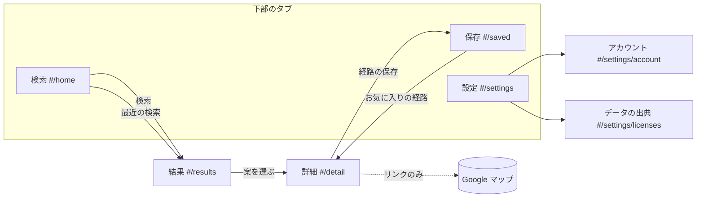

# GyrotraffIC スマホアプリの UI（試作 第 1 版・2026-10-19）

印：「推」＝推測、「不明」＝未確認。

## 結論（非エンジニア向け要約）
1. スマホ縦向き（基準 390×844・360×800、最小 320 幅）の試作画面を `ui/` に作った。`ui/index.html` をブラウザで開けば動く（ビルド・通信なし）。
2. 画面は 5 つ＋補助 2 つ：検索 → 結果 → 詳細、保存、設定（アカウント・データの出典）。
3. 表示しているのは、経路探索の中核（`gyrotraffic route --json`）を架空の合成路線網で実際に走らせた結果。駅名には「（架空）」の印。
4. 中核とは JSON の約束だけでつながる。いまはサンプルを読み、後で API に差し替える（データ層 1 ファイル）。
5. 結果は「最速・乗換最少・安値」を切り替え。運賃は「目安」か「運賃不明」と必ず書く（決定 #3）。
6. 詳細では乗り場（ホーム・出入口・バス停の向き）と、その確からしさを「確／推／不明」の文字・形・色で示す。
7. 飛行機の区間には「空港での余裕時間 30 分（推）」の説明を出す。
8. 検索の履歴は端末の中だけ。クラウドに保存するのはお気に入りの経路・よく使う場所・設定だけ、と画面に明記（決定 #4）。
9. ライト／ダーク、日本語／英語の切り替えの仕組みあり（英語は一部、未訳は日本語で出る）。
10. 自動検査（3 画面サイズ × 2 テーマ）で、エラー 0・横スクロールなし・タップ 44px 以上・コントラスト AA（簡易）を確認。実機のスマホでは未確認。

## 画面の一覧と遷移

| 画面 | 目的（1 画面 1 目的） | 主な中身 |
|---|---|---|
| 検索 | どこからどこへ、いつ | 出発地・目的地（入れ替え）、時刻（今・出発・到着）、よく使う場所、最近の検索（端末内）、下部に「検索」 |
| 結果 | 案を比べて選ぶ | 最速・乗換最少・安値のタブ、各案の所要時間・発着時刻・乗換回数・手段のアイコン列・運賃（目安／運賃不明） |
| 詳細 | 迷わず乗る | 区間ごとのタイムライン（乗車・降車・路線・方面・時刻・徒歩・乗換の待ち）、乗り場と確からしさ、空港の余裕時間、Google マップへのリンク、保存 |
| 保存 | 繰り返し使う | お気に入りの経路、よく使う場所（追加・削除）、クラウドに保存するものの説明 |
| 設定 | 好みと説明 | テーマ、言語、履歴の説明と「履歴の消去」、アカウント（模擬）、データの出典とライセンス |

## データの約束（中核 → UI）
UI は `GT.data`（`ui/js/data/`）だけからデータを得る。いまは `static-provider.js` が `ui/sample/` を返す。

| 呼び出し | 返すもの | 中核での出どころ |
|---|---|---|
| `route({from, to, mode, time})` | `{ journeys: Journey[], searchMs }` | `gyrotraffic route --json` の出力そのまま（`src/journey.ts`） |
| `places()` | `[{id, name, kind, lat, lon}]` | 駅（GTFS の stops）。地名・住所の検索は中核に無い（UI の仮の形） |
| `stopAccess(stopId)` | `{platform, entrance, heading, terminalNote, confidence, source}` | **中核に無い**（中枢設計 3 章の STOP_POINT・ENTRANCE を想定した推の形） |

Journey の項目と UI での使い方：
- `departureIso`・`arrivalIso` → 発着の時刻（先頭 16 文字の HH:MM）。`arrival - departure`（秒）→ 所要時間。
- `transfers` → 「乗換 n 回」「乗換なし」。乗換最少タブの並び。
- `legs[]`：`type:"transit"` は `mode`（アイコン）・`routeName`・`headsign`（〜方面）・`from/to.name`・`intermediateStops`。`type:"walk"` は `duration` と `source`（`change`＝乗換の待ち、`geo`＝距離からの推定で「推」の札）。
- `fare`（`FareEstimate | null`）→ `kind:"estimate"` は「目安 ¥…」、`unknownLegs` があれば「＋」と「一部の区間は運賃不明」、null は「運賃不明」。安値タブは運賃がある案だけで比べ、不明は後ろ。
- 飛行機・フェリーの余裕時間は、中核の `DEFAULT_MODE_PROFILES.boardSlack`（air 1800 秒・ferry 600 秒）を UI に写した値。API ではレスポンスに含めてほしい（下の未決定 3）。
- サンプルの再生成：`ui/sample/gtfs-synthetic/` で `node dist/src/cli.js route --gtfs ui/sample/gtfs-synthetic --from S_HOKU --to BUS_KAI --depart 2026-10-20T07:55:00+09:00 --json`。封筒（`format`・`id`・`query`）と架空の `fare` を足し、`node ui/tests/gen-samples.mjs` で `samples.js` を作る（file:// で JSON を読めないため）。

## 決めた設計と理由
- **ビルド不要・ES モジュール不使用**：file:// で開くと Chrome は ES モジュールと fetch を止めるため、順に読む普通のスクリプトにした。
- **下部のタブ 3 つ（検索・保存・設定）と下部の主ボタン**：親指で届く範囲。名前は名詞。タップ領域は 44px 以上（主ボタン 52px）。
- **色だけに頼らない**：確からしさは「確＝塗りの丸＋チェック」「推＝半分塗りの三角」「不明＝破線の丸＋？」と文字。運賃は「目安」「運賃不明（斜体）」の文字。選択中のタブは枠・下線・点も。
- **安全領域**：`viewport-fit=cover` と `env(safe-area-inset-*)` を上部・下部・左右に。
- **PC では中央に 390×844 の枠**（幅 600px 以上かつ高さ 760px 以上のとき）。スマホでは全画面（`100dvh`）。
- **保存層**：localStorage を try/catch。使えなければメモリに置き、設定画面に「保存が使えません」と出す。キーは `local.*`（端末のみ）と `cloud.*`（将来クラウド同期）で分けた。
- **Google マップ**：公式の Maps URLs 形式のリンクだけ。API・スクレイピングなし。架空の駅は座標（架空）で渡す。
- **動き**：色の変化だけ、`prefers-reduced-motion` のときは無し。外部フォントなし（端末の日本語フォント）。

## 検証（`ui/tests/check.mjs`）
`NODE_PATH=/opt/node-tools/node_modules node ui/tests/check.mjs`。390×844・360×800・320×640 × ライト／ダークで、検索→結果→詳細（保存）→飛行機の詳細→保存→設定（履歴の消去）を通し、コンソールエラー・外部通信・横スクロール・タップ領域・ラベル・コントラスト（簡易）を検査。PC の枠の大きさ、localStorage が使えない場合も確認。2026-10-19 の結果：すべて合格・41 枚・2.3MB（`docs/ui-screens/`）。
- コントラストの検査は背景を親要素の背景色からたどる簡易版。半透明・グラデーションの上の文字は正確でない（推）。
- 画面読み上げ（VoiceOver・TalkBack）での確認はしていない（不明）。

## 未決定（所有者に決めてほしいこと）
1. **出発地・目的地の入力**：駅名だけか、住所・地図上の地点も入れるか。推奨：最初は駅・バス停・空港の名前だけ（中核が住所からの徒歩に未対応）。
2. **アプリの形**：PWA（ウェブ）で先に出すか、ネイティブ（App Store・Google Play）か。推奨：試作は PWA、乗り場の案内が固まってからネイティブの包み（推）。
3. **API の形**：中核の Journey をそのまま返すか、UI 用に余裕時間・乗り場・運賃を足した形にするか。推奨：Journey に `boardSlack` と `stopAccess` を足した形（UI の変更が最小）。
4. **英語の対応時期**：推奨：画面の文言は辞書に切り出し済みなので、日本語の文言が固まってから一括で訳す。
5. **ブランドの色**：いまは仮の青（#0a58d0）。推奨：色を決めるときも、確からしさ・運賃は形と文字を残す。

## 今回作らなかったもの
- 地図の表示（乗り場の地図・経路の線）
- 実際の経路探索との接続（API・サーバ）。いまは静的サンプルのみで、サンプルにない組み合わせは「見つかりませんでした」
- ログインの実装（画面だけの模擬。何も送らない）とクラウドへの同期
- 通知（遅延・発車の知らせ）、遅延の表示、運賃の計算
- 実機のスマホでの確認（ノッチ・ホームバーの見え方は不明）
